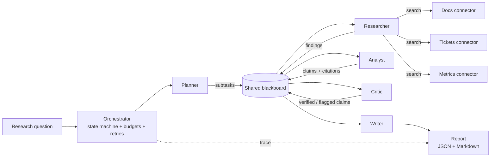

# Multi-Agent Research & Automation System

An enterprise-grade, fully offline multi-agent workflow that researches a
question and produces a **structured, citation-verified report**. An
orchestrator runs five specialized agents — **planner, researcher, analyst,
writer, critic** — as an explicit state machine over a shared blackboard.
Every claim in the final report carries citations, and a critic agent
verifies each claim against its sources before anything is published.

## Why this exists

Automated research pipelines fail in a predictable way: a fluent model
generates plausible text, and nobody can tell which sentences came from
evidence and which were invented. This system is designed around that
failure mode:

- **Decomposition before retrieval** — the planner splits the question into
  five aspect subtasks (landscape, evidence, operations, risks, actions), so
  coverage gaps are visible instead of silent.
- **Citations are structural, not decorative** — a claim cannot exist
  without the source ids it was extracted from.
- **Verification is a separate agent** — the critic re-checks every claim
  against the full text of its cited sources and flags unsupported ones.
  Flagged claims stay in the report, visibly marked, with a confidence
  score for the whole document.
- **Bounded autonomy** — per-agent tool access, retries, and a global step
  budget. Every run emits a human-readable trace that ships in the report.

## Architecture



States: `idle → planning → researching → analyzing → reviewing → writing →
completed` (any active state can fall to `failed`). See
[docs/architecture.md](docs/architecture.md) for design details, the
blackboard contract, and production-hardening notes.

## Quickstart

```bash
python -m venv .venv && source .venv/bin/activate
pip install -e ".[dev]"

# CLI demo (offline, deterministic)
python -m research_system.cli \
  "How can we reduce cloud infrastructure costs without hurting reliability?" \
  --out out/ --trace

# API service
uvicorn research_system.api:app --port 8000
curl -X POST localhost:8000/jobs \
  -H 'content-type: application/json' \
  -d '{"question": "How can we reduce support ticket volume?"}'
curl "localhost:8000/jobs/job-0001/report?format=md"
```

Docker:

```bash
docker build -t multi-agent-research-automation .
docker run -p 8000:8000 multi-agent-research-automation
```

## API

| Method | Path | Description |
|---|---|---|
| POST | `/jobs` | Submit a question; returns the job with its report (runs are synchronous and fast over the bundled corpora). |
| GET | `/jobs/{id}` | Job status; includes the full report when completed. |
| GET | `/jobs/{id}/report?format=json\|md` | The report as JSON or Markdown. |
| GET | `/jobs/{id}/trace` | Human-readable run trace (states, agents, retries). |
| GET | `/sources` | The corpora the connectors can search. |
| GET | `/health` | Liveness + corpus size. |

## Example output

`examples/` contains a ready-made request (`example_request.json`) and a
real generated report (`sample_report.md`) for the question *"How can we
reduce cloud infrastructure costs without hurting reliability?"* — note the
**Verification & Confidence** section and the **Claim Audit Trail**: every
claim lists its term-support score against its cited sources.

## Testing

```bash
pytest
```

The suite covers retrieval ranking/determinism, planner decomposition,
orchestrator state order, retry recovery and exhaustion, step-budget
aborts, critic verification/flagging, and the full API surface.

## How it works, briefly

1. **Planner** decomposes the question into aspect subtasks with steered
   search queries.
2. **Researcher** (the only agent with connector access) searches the
   docs/tickets/metrics corpora and stores cited passages as findings.
3. **Analyst** converts the best passage sentences into extractive claims,
   each bound to its source id.
4. **Critic** verifies citations resolve and measures how much of each
   claim's wording is supported by its sources; low-support claims are
   flagged, never hidden.
5. **Writer** composes the executive summary and per-aspect sections with
   numbered citation markers, plus the bibliography.

Retrieval is a transparent weighted term-overlap ranker (title > tags >
body) chosen so the whole pipeline runs offline and deterministically —
same question, same corpora, same report.

## Limitations

- The bundled corpora are **synthetic** and small (20 items) — a demo
  dataset, not a knowledge base.
- Claims are extractive (verbatim source sentences). That maximizes
  verifiability but limits synthesis; abstractive claims would need a
  stronger critic (e.g. entailment checking).
- Lexical retrieval misses paraphrases; a hybrid vector index is the
  planned upgrade (interface is already isolated in `retrieval.py`).
- The API job store is in-memory and runs synchronously; production use
  needs a queue, persistence, and per-tenant corpora.

## Roadmap

- Pluggable LLM-backed planner/analyst behind the same agent interfaces,
  with the deterministic agents as fallback and test oracle.
- Hybrid retrieval (BM25 + embeddings) and cross-encoder reranking.
- Entailment-based critic and contradiction detection between sources.
- Async job execution (queue + workers), persistent job store, streaming
  trace over SSE.
- New connectors: web search, SQL warehouse, incident systems — the
  `SourceConnector` interface already supports them.

## License

MIT — see [LICENSE](LICENSE).
